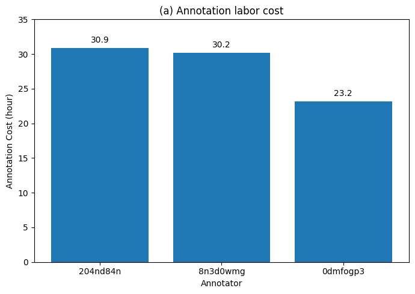
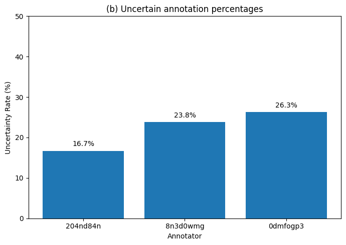
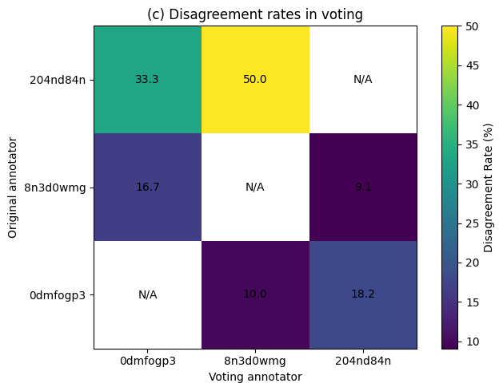

## 1. Dataset Overview

**Dataset:** Who & When  
**Source:** Hugging Face — `Kevin355/Who_and_When`

The Who & When dataset contains traces from multi-agent systems in which an error or failure occurs during a sequence of interactions.

For this project, the dataset will be used to study **detection lag**: how many steps pass between the point where the decisive error occurs and the point where that error becomes detectable from the trace.

---

## 2. Research Question

The main research question is:

> **How long does an error stay invisible after it first occurs?**

Detection lag can be represented as:

```text
Detection Lag = First Detectable Step - Decisive Error Step
```

A lag of `0` means the error is detectable immediately.

A larger lag means the system continues operating for several steps before there is enough evidence to identify the error.

---

## 3. Dataset Categories

The dataset contains two broad categories:

- **Algorithm-Generated**
- **Hand-Crafted**

These traces represent different multi-agent scenarios in which failures have been annotated.

---

## 4. Dataset Files

The raw dataset is stored under:

```text
data/Who&When/
```

The dataset primarily contains JSON files.

Each JSON file represents a trace or task.

The dataset inventory script recursively examines these files and records:

- file path
- file size
- JSON structure
- available fields
- number of records where applicable

---

## 5. Important Fields

Initial inspection shows fields related to the task, conversation trace, and annotated failure.

Fields of particular interest include:

| Field            | Purpose                                     |
| ---------------- | ------------------------------------------- |
| `question`       | Original task or problem                    |
| `question_ID`    | Identifier for the task                     |
| `history`        | Sequence of agent interactions/actions      |
| `ground_truth`   | Expected correct outcome                    |
| `mistake_agent`  | Agent responsible for the annotated mistake |
| `mistake_step`   | Step where the mistake occurred             |
| `mistake_reason` | Explanation of the mistake                  |

These fields may vary slightly between records and should be verified during exploratory analysis.

---

## 6. Unit of Analysis

The primary unit of analysis will be a **trace**.

A trace consists of an ordered sequence of interactions stored in the `history` field.

Each history entry can potentially provide signals indicating whether an earlier error has become visible.

---

## 7. Initial Variables

Variables expected to be useful include:

```text
trace_id
dataset_type
trace_length
mistake_agent
mistake_step
mistake_reason
first_detectable_step
detection_lag
```

Additional features may later be extracted from the trace, such as:

- message length
- contradictions
- failed actions
- anomaly indicators
- explicit correction attempts
- LLM-based suspicion scores

---

## 8. Exploratory Questions

Before building a detection method, the exploratory analysis should answer:

1. How many traces are available?
2. How many traces are Algorithm-Generated versus Hand-Crafted?
3. How long are the traces?
4. At what step do annotated mistakes usually occur?
5. Which agents are most frequently associated with mistakes?
6. What types of mistakes occur?
7. Do errors usually become obvious immediately or several steps later?
8. Are some error types associated with longer detection lags?
9. Are there traces where the failure never becomes clearly detectable?
10. What observable signals tend to appear after the decisive error?

## 9. Manual Trace Inspection

As part of understanding how the Who & When dataset was constructed, the annotation analysis reported in the original paper was reproduced.

The reproduction focuses on the three panels presented in **Figure 2**:

- **(a) Annotation labor cost**
- **(b) Uncertain annotation percentages**
- **(c) Disagreement rates in voting**

The purpose of this reproduction is to understand the amount of human effort required to annotate failures, how frequently annotators were uncertain about their initial decisions, and how often annotators disagreed when uncertain cases were reviewed.

### 9.1 Annotation Labor Cost

The paper reports the total amount of time spent by each of the three annotators.

| Annotator  | Annotation Time (Hours) |
| ---------- | ----------------------: |
| `204nd84n` |                    30.9 |
| `8n3d0wmg` |                    30.2 |
| `0dmfogp3` |                    23.2 |

The total reported annotation effort is:

```text
30.9 + 30.2 + 23.2 = 84.3 hours
```



**Figure 2(a).** Annotation labor cost for the three annotators. The three annotators spent a combined 84.3 hours reviewing and annotating failure traces.

This demonstrates that identifying the responsible agent and decisive error step required substantial manual inspection of the multi-agent traces.

### 9.2 Uncertain Annotation Percentages

During the initial annotation process, annotators could indicate that they were uncertain about an annotation.

The uncertainty rate can be represented as:

```text
Uncertainty Rate =
Number of Uncertain Annotations / Total Annotations × 100
```

The percentages reproduced from Figure 2 are:

| Annotator  | Uncertain Annotations |
| ---------- | --------------------: |
| `204nd84n` |                 16.7% |
| `8n3d0wmg` |                 23.8% |
| `0dmfogp3` |                 26.3% |

These results show that a meaningful portion of the traces were not straightforward to annotate. In some cases, determining exactly which agent made the mistake or where the decisive error occurred required additional review.



**Figure 2(b).** Percentage of annotations marked as uncertain by each annotator during the initial annotation process.

This uncertainty is particularly relevant to the detection-lag research question because an error that is difficult for a human annotator to identify may also remain difficult to detect from the trace immediately after it occurs.

### 9.3 Disagreement Rates in Voting

Uncertain annotations were reviewed by other annotators. Before discussion and consensus, reviewers sometimes disagreed with the original annotation.

The disagreement rate can be represented as:

```text
Disagreement Rate =
Number of Disagreements / Number of Uncertain Annotations Reviewed × 100
```

The voting disagreement matrix reproduced from Figure 2 is:

| Original Annotator | `0dmfogp3` | `8n3d0wmg` | `204nd84n` |
| ------------------ | ---------: | ---------: | ---------: |
| `204nd84n`         |      33.3% |      50.0% |        N/A |
| `8n3d0wmg`         |      16.7% |        N/A |       9.1% |
| `0dmfogp3`         |        N/A |      10.0% |      18.2% |

The disagreement rates show that some failure traces allowed multiple reasonable interpretations before the annotators discussed the cases and reached consensus.



**Figure 2(c).** Disagreement rates between annotators when uncertain annotations were reviewed before discussion and final consensus.

### 9.4 Reproduction Limitation

An important distinction is made between **reconstructing the published figures** and **independently recalculating the annotation statistics**.

The released dataset provides the finalized failure annotations needed for failure-attribution experiments. However, the intermediate human annotation information required to independently calculate all three Figure 2 statistics may not be available in the final dataset.

In particular, independent reproduction would require records containing information such as:

```text
task_id
annotator
annotation_start
annotation_end
uncertain
reviewer
original_decision
review_decision
```

Therefore, the Figure 2 notebook reconstructs the visualizations using the values reported in the paper rather than claiming that all values were independently derived from the released Who & When dataset.

This distinction will be maintained throughout the project so that results calculated directly from the dataset are clearly separated from results reproduced from the published paper.

### 9.5 Connection to Detection Lag

The annotation analysis provides useful motivation for studying detection lag.

The uncertainty and disagreement observed among human annotators suggest that the decisive error is not always immediately obvious from a multi-agent trace. An error may occur at one step, while convincing evidence that the action was incorrect may only appear later.

This motivates the central question of this project:

> **After the decisive mistake occurs, how many additional interaction steps are required before enough evidence exists to detect it?**

The next stage of the analysis therefore moves from the paper's human annotation statistics to direct inspection of individual traces and identification of the **first detectable step**.

---

## 10. Manual Trace Inspection

The next stage of the project will manually inspect selected traces to understand how failures develop over time.

For each trace, the analysis will compare:

```text
mistake_step
```

with the proposed:

```text
first_detectable_step
```

The difference between these two values will provide the initial measurement of detection lag:

```text
detection_lag = first_detectable_step - mistake_step
```

Manual inspection will also help establish criteria for deciding when an error becomes detectable and identify observable signals that can later be used for automated detection.
